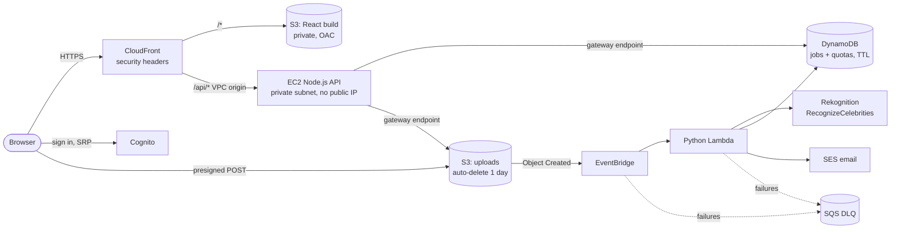

# Celebrity Face Detector

Upload a photo and the app tells you which celebrities are in it: names, confidence, and a box drawn around each face. You can also get the result by email. It's a three-tier AWS application defined entirely in CloudFormation, built to be secure and to cost close to nothing while idle.

**Stack:** React · Node.js (Express) on EC2 · Python Lambda · Amazon Rekognition · S3 · DynamoDB · Cognito · CloudFront · SES · EventBridge · VPC · CloudFormation

## Architecture



| Tier | What | Where |
|---|---|---|
| Presentation | React SPA served by CloudFront from a private S3 bucket | `web/`, `infra/06-edge.yaml` |
| Application | Express API on EC2 (t4g.micro, Graviton) plus an event-driven Python Lambda | `api/`, `lambda/`, `infra/05-app.yaml`, `infra/04-processing.yaml` |
| Data | DynamoDB single table, S3 uploads bucket | `infra/02-data.yaml` |

### Request flow
1. The user signs in with Cognito (SRP, so the password never leaves the browser in plain form).
2. `POST /api/jobs`: the API checks the user's daily quota, creates a `PENDING` job, and returns a **presigned POST**. S3 itself enforces the key, the 1 KB–5 MB size range and the content type.
3. The browser resizes the image, which also strips EXIF/GPS data, and uploads it **directly to S3**.
4. S3 emits an `Object Created` event to EventBridge, which invokes the Lambda. The Lambda checks the file's magic bytes, calls Rekognition, saves the result and optionally emails it. The recipient address comes from Cognito, never from the client.
5. The browser polls `GET /api/jobs/:id` and draws the bounding boxes.

## Security decisions

| Control | How |
|---|---|
| No exposed servers | EC2 sits in a private subnet with no public IP, no SSH and no key pair. Only CloudFront (VPC origin) can reach it, and its security group allows only CloudFront's managed prefix list. |
| No internet egress | No NAT gateway. Egress is limited to HTTPS to the S3 and DynamoDB gateway endpoints. Endpoint policies only allow resources **in this account**, which blocks exfiltration to another account's bucket. |
| No static credentials | EC2 and Lambda use IAM roles. There are no access keys anywhere in the code or config. |
| Least privilege | One role per component, each scoped to specific ARNs and key prefixes (`uploads/*`, `app/*`). `RecognizeCelebrities` is the only `*` resource, because it doesn't support resource-level permissions. |
| Instance hardening | IMDSv2 required (hop limit 1), encrypted EBS, and a sandboxed systemd unit (non-root user, `ProtectSystem=strict`, `NoNewPrivileges`, no capabilities). |
| Auth | Cognito access tokens are verified on every API call (signature, expiry, client ID). The JWKS is pinned at deploy time because the instance can't reach the internet. |
| Tenant isolation | The DynamoDB partition key and S3 prefix both come from the verified token's `sub`, so users can't reference each other's jobs. |
| Input validation | Content type is allow-listed, size is enforced by S3, magic bytes are checked in the Lambda, job IDs and S3 keys are validated with regexes, and JSON bodies are capped at 2 KB. |
| Abuse / cost control | Per-user daily upload quota (atomic DynamoDB counter) and a per-user API rate limit. |
| Data protection | Everything is encrypted at rest, every bucket policy denies non-TLS requests, S3 Block Public Access is on, photos auto-delete after 1 day, and users can delete their own data immediately. |
| Browser | Strict CSP (no inline scripts), HSTS, `X-Frame-Options: DENY`, `nosniff`, `Referrer-Policy`. |
| Reliability | EventBridge retries plus a Lambda on-failure destination feeding an encrypted SQS dead-letter queue. Processing is idempotent (conditional writes). |
| Supply chain / CI | `cfn-lint`, `checkov` (every skipped check has a written reason in the template), unit tests, `npm audit`, and gitleaks secret scanning in GitHub Actions and as a pre-commit hook. The Node.js runtime download is checksum-verified. |

### What's deliberately left out (cost)
- **AWS WAF**: it has a fixed monthly fee. Rate limiting is done per user in the API instead.
- **Customer-managed KMS keys**: AWS-owned/managed keys are free.
- **Access logs, PITR and versioning on ephemeral data**: they add cost with no benefit for 24-hour data.
- **Minimum TLS 1.2**: this needs a custom domain and an ACM certificate. The default `*.cloudfront.net` certificate can't set it.
- **High availability**: there's a single instance, though there are two subnets in two AZs so an Auto Scaling group can be added later.

## Cost

Prices are on-demand, us-east-1, checked Nov 2026. Confirm them in the [AWS Pricing Calculator](https://calculator.aws/).

| Item | Price | Testing estimate |
|---|---|---|
| EC2 t4g.micro | $0.0084/hr (~$6.13/month if left on 24/7) | ~$0.20 per day it's running |
| EBS 8 GB gp3 | about $0.64/month | cents |
| Rekognition RecognizeCelebrities | $0.001 per image | 500 images ≈ $0.50 |
| NAT gateway, load balancer, public IPv4 | **$0: none used** | $0 |
| CloudFront, S3, DynamoDB on-demand, Lambda, SES, EventBridge, SQS | usage-based, tiny at this scale | under $1 |

The bootstrap stack creates an **AWS Budget** ($5 by default) that emails you at 50%, at 100%, and when the forecast passes 100%. T4g burst credits are set to `standard`, so the instance can't bill extra CPU charges.

When you're not using it, run `./scripts/pause.sh` (stops EC2) or `./scripts/destroy.sh` (deletes everything).

## Deploy

**Prerequisites (on your Mac)**
- AWS CLI v2, signed in through IAM Identity Center (`aws configure sso`) or an IAM user with MFA. Don't use root access keys.
- Node.js 22+ and npm. Python 3 is only needed for the tests.

```bash
ALERT_EMAIL=you@example.com ./scripts/deploy.sh
```

The script deploys 7 stacks in order, packages the Lambda, builds the API bundle (Node runtime + app + pinned JWKS, content-hashed), deploys CloudFront, then builds the React app and uploads it. The first deploy takes about 15–25 minutes, mostly CloudFront.

After it finishes:
1. Click the **SES verification link** sent to `ALERT_EMAIL`. Until then, result emails fail but everything else works. SES starts in sandbox mode, so emails only go to verified addresses, and you sign up with the same address.
2. Open the site URL, create an account (Cognito emails you a code), and upload a photo.

**Debugging (no SSH by design)**
```bash
./scripts/logs.sh boot     # EC2 bootstrap output via the serial console
./scripts/logs.sh lambda   # follow the processor's logs
./scripts/logs.sh dlq      # failed events waiting in the dead-letter queue
curl https://<site>/api/health
```

**Tear down**
```bash
./scripts/destroy.sh
```

## Stacks

| # | Stack | Contents |
|---|---|---|
| 00 | bootstrap | Artifacts bucket, cost budget |
| 01 | network | VPC, 2 private subnets, IGW (required by VPC origins, no routes to it), S3/DynamoDB gateway endpoints |
| 02 | data | Uploads bucket (lifecycle, CORS, EventBridge), DynamoDB table (TTL) |
| 03 | auth | Cognito user pool + SPA client |
| 04 | processing | SES identity, Lambda, EventBridge rule, DLQ |
| 05 | app | Security group, IAM role, launch template, EC2 instance |
| 06 | edge | Web bucket, OAC, VPC origin, cache/header policies, CloudFront |

The stacks share values through CloudFormation exports. The instance ARN is passed to the edge stack as a parameter instead, so replacing the instance on a new app bundle isn't blocked by an export that another stack is using.

## Local development
```bash
python -m pytest tests/                      # Lambda tests
(cd api && npm ci && npm test)               # API tests
cfn-lint && checkov -d infra --framework cloudformation
cd web && npm ci && VITE_USER_POOL_ID=... VITE_CLIENT_ID=... VITE_API_PROXY=https://<site> npm run dev
```

## Project layout
```
infra/            CloudFormation templates (00–06)
lambda/processor/ Python Rekognition worker
api/              Node.js API (src/app.js = routes, src/aws.js = AWS adapters)
web/              React (Vite) frontend
scripts/          deploy / destroy / pause / logs
tests/            Lambda unit tests
```
